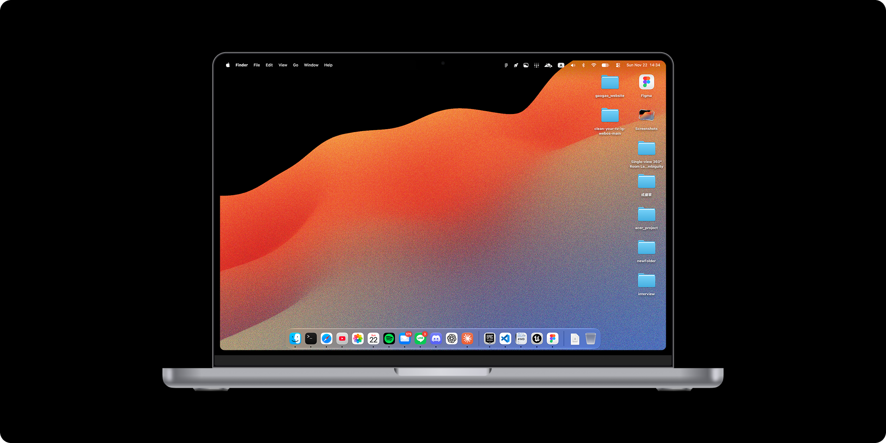
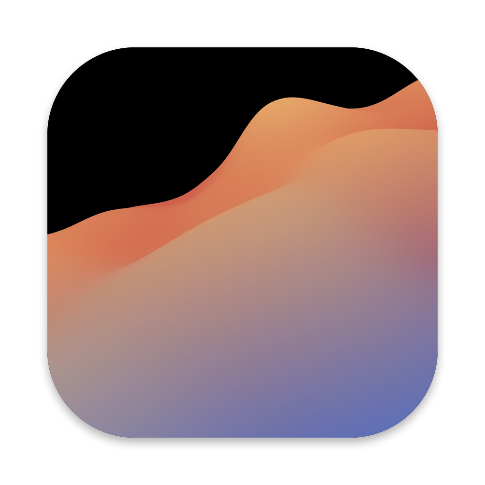
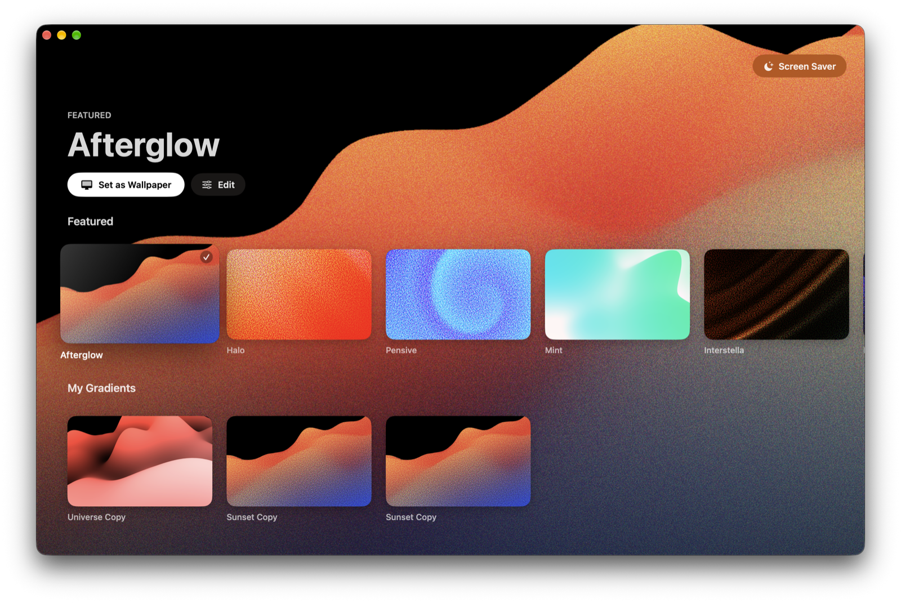
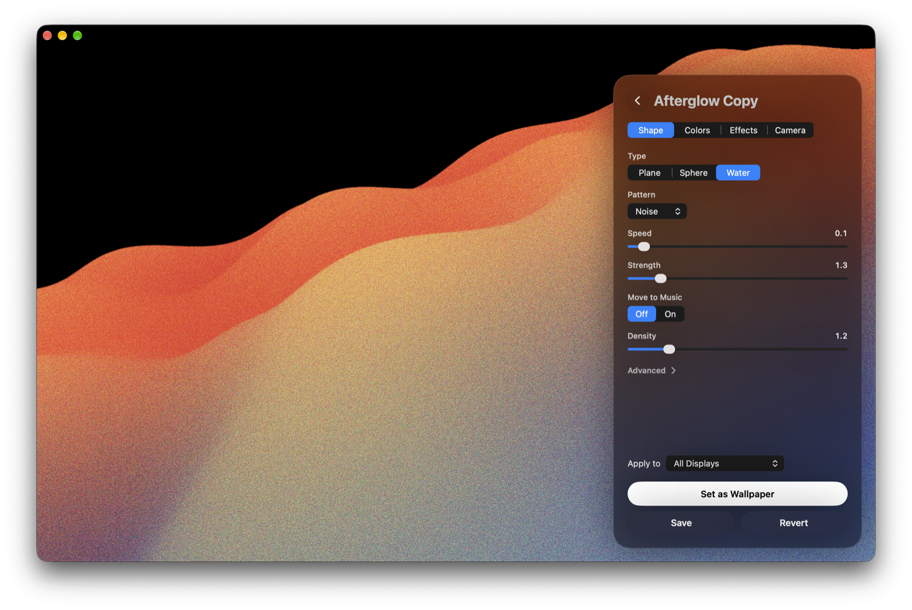

<p align="center">
  
</p>

<p align="center">
  
</p>

<h1 align="center">Hueflow</h1>

<p align="center">
  Living 3D gradient wallpapers and a screen saver for macOS, rendered natively with Metal.<br>
  Free and open source.
</p>

<p align="center">
  <a href="https://github.com/noah312831013/hueflow/releases/latest/download/Hueflow.zip"><b>Download</b></a>
  &nbsp;·&nbsp;
  <a href="https://hueflow-eight.vercel.app">Website</a>
  &nbsp;·&nbsp;
  <a href="LICENSE">MIT License</a>
</p>

<p align="center"><sub>macOS 14 Sonoma or later · Apple silicon &amp; Intel</sub></p>

## Install

1. Download **Hueflow.zip** from the [latest release](https://github.com/noah312831013/hueflow/releases/latest) and unzip it.
2. Move **Hueflow.app** to Applications and open it.
3. The app isn't notarized by Apple, so macOS blocks the first launch. Open **System Settings › Privacy & Security**, scroll
   down and click **Open Anyway** next to Hueflow. Or run once in Terminal:
   ```sh
   xattr -dr com.apple.quarantine /Applications/Hueflow.app
   ```

## Gallery

Pick a gradient and set it as your wallpaper, on every display or one at a time.

<p align="center"></p>

## Editor

Reshape any gradient live: shape, patterns, colors, light, effects and camera. Save your own and use them as wallpapers or
in the screen saver.

<p align="center"></p>

## Features

- **Live 3D wallpapers** behind your icons and menu bar, with smooth transitions when you switch or tweak a gradient.
- **Screen saver**, both a built-in idle screen saver and one for System Settings.
- **Music reactivity:** gradients can move and shift color with the bass of whatever your Mac is playing (macOS 14.2+).
- **Light on battery:** pauses on battery, behind full-screen apps and when covered, plus performance options in the menu bar.
- **MacBook Pro corners:** an optional black menu bar and rounded bottom corners that match the physical screen.
- **Private:** no account, no tracking, no network access.

## Development

```
native/   the Mac app (Swift + Metal), built with swiftc; no Xcode project
site/     the website (static HTML)
```

### The app

- **Rendering:** a Metal port of [ShaderGradient](https://github.com/ruucm/shadergradient) (MIT, © ruucm). It covers the plane, water and sphere shapes, the noise, the color formulas, the camera and the halftone grain. Wallpapers, the gallery, thumbnails and the screen saver all share one renderer.
- **Beyond ShaderGradient:** shape and color patterns (noise, warp, cells, ridged, waves) with scale and sharpness, mesh subdivision, grain amount and size, music-reactive strength (a Core Audio tap on the system output follows the bass; macOS 14.2+), depth-of-field bokeh (focus and blur, a 16-tap gather on the scene before the grain), optional 4× MSAA (on by default) and an optional Retina-resolution grain pass for smoother silhouettes. Gradients that use these no longer match shadergradient.co.
- **UI:** an Apple TV–style gallery and a live editor (Shape / Colors / Effects / Camera), and saved gradients.
- **System:** a desktop-level window per display (each can be enabled and assigned separately) and a 🌈 menu bar item. It pauses on demand, on battery or behind full-screen apps, and has an idle screen saver. A Performance submenu holds five options, all on by default: 30 fps wallpapers, a half-resolution 3D scene (grain stays full resolution), pausing while covered, depth/MSAA buffers in GPU tile memory, and 15 fps in Low Power Mode or when the Mac runs hot. `native/bench.sh` measures the GPU time per frame.
- **System Settings `.saver`:** the same Metal renderer, installed from the Screen Saver popover.
- **Built-in display:** optional black menu bar and rounded bottom corners that match the MacBook Pro's physical screen corners (menu bar › Displays).

```sh
cd native
./build.sh      # build/Hueflow.app + build/Hueflow.zip; needs Xcode
./test.sh       # self-checks
open build/Hueflow.app
```

Settings are stored in `~/Library/Application Support/Hueflow/config.json`.

"Environment" lighting approximates the city/dawn/lobby HDRs with a procedural sky, so those presets differ slightly from shadergradient.co.

### The website

`site/index.html` is the landing page and `site/legal.html` holds the license and privacy notes. The hero gradient and the "Make it yours" editor use the ShaderGradient React library. `site/build.mjs` hooks the library's shader compile so `site/src/patterns.js` can add the app's patterns to the editor. The hook matches `@shadergradient/react` 2.4.20 exactly (pinned in `package.json`), and the build fails if a library update changes that code. Bundle with:

```sh
npm install
npm run build   # site/hero.js
```

The gallery cards in `site/assets/cards/` are rendered by the app's own renderer, supersampled so the grain doesn't turn into moiré. Regenerate them after changing presets:

```sh
native/site-thumbs.sh
```

Host `site/` on any static host (Vercel, Netlify, GitHub Pages).

### Releasing

Bump `CFBundleShortVersionString` and `CFBundleVersion` in `native/App/Info.plist` and `native/Saver/Info.plist`, then:

```sh
native/build.sh
gh release create v1.2.0 native/build/Hueflow.zip --title "Hueflow 1.2.0" --notes "..."
```

The website's Download buttons point to `releases/latest/download/Hueflow.zip`, so they pick up the new release automatically.

To ship a build that opens without the Gatekeeper warning, join the Apple Developer Program, create a Developer ID
Application certificate and run:

```sh
xcrun notarytool store-credentials hueflow   # once
DEVELOPER_ID="Developer ID Application: Your Name (TEAMID)" NOTARY_PROFILE=hueflow native/build.sh
```

## License

MIT, see [LICENSE](LICENSE). The rendering is a port of [ShaderGradient](https://github.com/ruucm/shadergradient) by ruucm (MIT).
